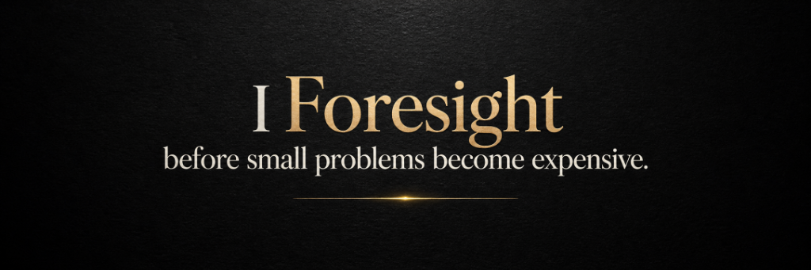
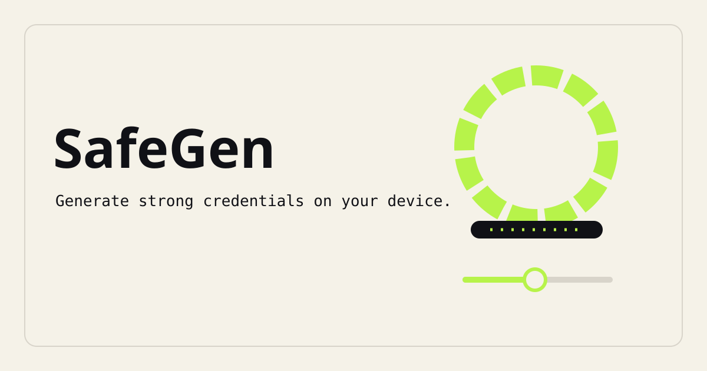
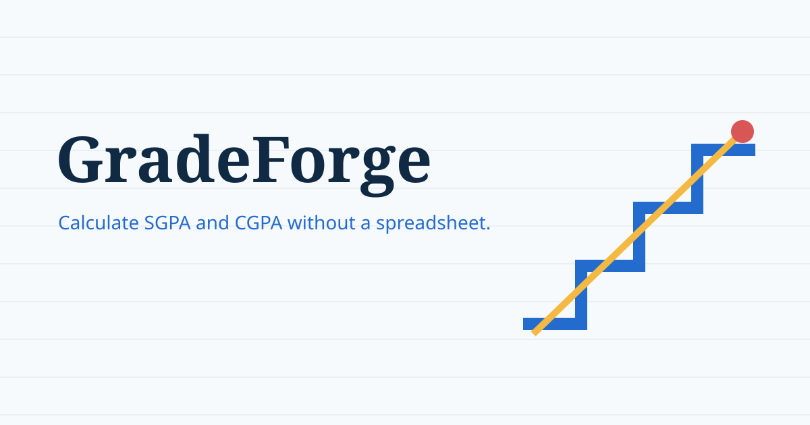
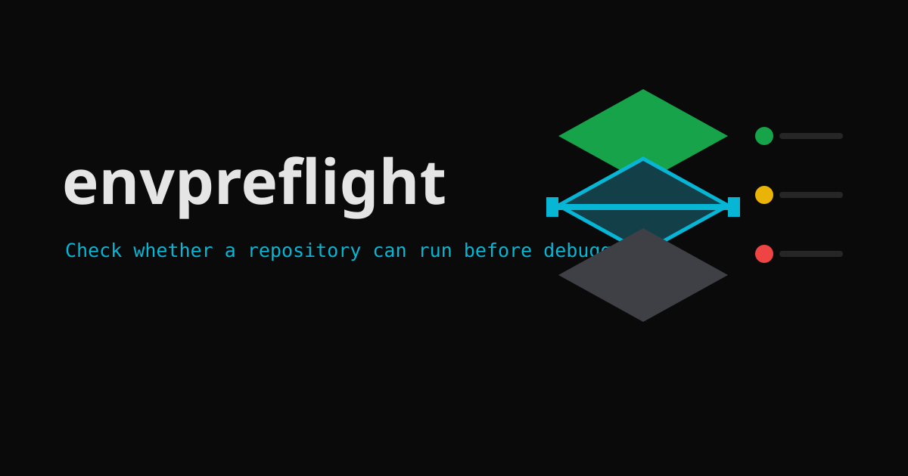
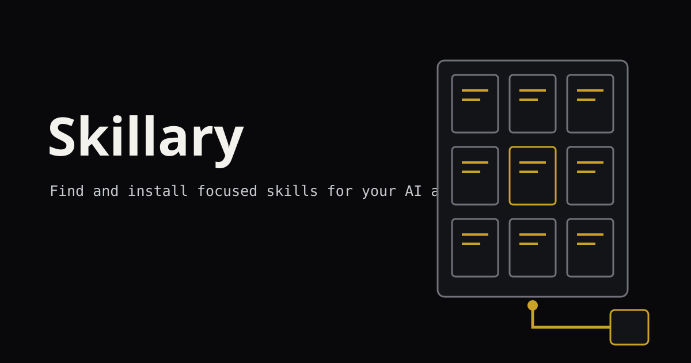
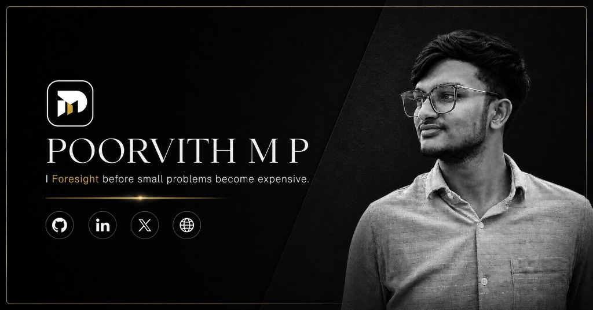
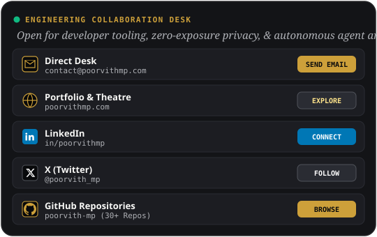

<!-- Top Banner: Foresight Wide -->

  

<!-- Logo & Core Profile Identity -->

# POORVITH M P

### <i>I Foresight before small problems become expensive.</i>

  <strong>Open Source Builder / Student Builder • Local-First Privacy & AI Agent Systems</strong>
   
  Student Developer • Indie Builder

<!-- Live Animated System Indicator -->

  

<!-- Identity Action Badges -->

  
  
  
  
  

---

## 🏛️ About Me & The Foresight Principle

I'm a B.Tech Computer Science and Engineering student at Presidency University and an open-source builder. I look for the friction developers learn to tolerate, turn it into a focused tool, and keep every decision visible from the first check to the working code.

Most software failures don't start as big outages. They start when an API key gets pasted into an LLM prompt, a local `.env` drifts from what the repo expects, a stack trace gets filed without git or runtime context, or an agent runs with vague instructions.

That's what **Foresight** means in my work: catch the failure mode on your own machine before it leaves your browser, breaks a build, or turns into an expensive cleanup.

 

<table>
<tr>
<td width="25%" align="center">
  <strong>🛡️ Foresight First</strong> 
  Catch leaks, runtime mismatches, and broken state before they leave your machine
</td>
<td width="25%" align="center">
  <strong>🔒 Zero-Exposure Privacy</strong> 
  100% browser-local Web Crypto workspaces and offline-first CLIs
</td>
<td width="25%" align="center">
  <strong>⚡ Useful Before Impressive</strong> 
  Fast local execution, zero-signup web apps, and direct npx commands
</td>
<td width="25%" align="center">
  <strong>🔍 Honest Boundaries</strong> 
  Open source repositories, clear permission scopes, and documented limits
</td>
</tr>
</table>

---

## 🚀 My Tools

<table width="100%">
<tr>
<td width="50%" valign="top">

<!-- AIScrubber Card (Row 1, Left) -->

###  [AIScrubber](https://github.com/poorvith-mp/aiscrubber)
> **Browser-local AI privacy scrubber (`3.0.0`), CLI, and MCP server (`@poorvithmp/aiscrubber 2.4.0` · Release `v2.3.0`).**

- **The Problem:** Developers paste API keys, database URLs, and raw logs into LLM chats or public issues. Once a secret leaves your machine, you can't un-send it.
- **The Solution:** Runs 5 client-side workspaces: deterministic credential scrubber (stable `{{TYPE_N}}` tokens), reversible prompt roundtrip with AES-GCM encrypted `.aiscrub.json` vaults, zero-width Unicode watermark cleaner, image EXIF stripper, and canvas redactor.
- **Tech Stack:** React 19 · TypeScript · Web Crypto API · Tailwind CSS v4 · Vite · MCP Server · Node CLI

  
  
  

<strong>View architectural highlights</strong>

- 100% browser-local Web Crypto execution (`AES-GCM` encrypted session vaults) with zero telemetry
- Invisible LLM watermark stripper (`\u200B`, `\u200C`, `\u200D`, `\uFEFF`, `\u2060`)
- Terminal CLI (`npx @poorvithmp/aiscrubber`) and stdio MCP server (`aiscrubber-mcp`) for Claude Desktop, Cursor, and Codex
- Client-side JPEG/PNG/WebP EXIF metadata stripper and brush/box image redactor

</td>
<td width="50%" valign="top">

<!-- SafeGen Card (Row 1, Right) -->

###  [SafeGen](https://github.com/poorvith-mp/safegen)
> **Browser-local credential generator (`v2.0.0`) & owner-approved agent action broker (`@poorvithmp/safegen 3.1.1` · `core 2.2.0`).**

- **The Problem:** Online password generators can't be audited while you type, and telling an AI agent "don't leak my token" isn't a real permission boundary.
- **The Solution:** Combines a browser-local `crypto.getRandomValues()` credential generator (rejection sampling across Password, Passphrase, PIN, and Pattern modes) with a local owner-approved action broker CLI and MCP server for fixed GitHub and Cloudflare actions.
- **Tech Stack:** React 19 · TypeScript · Web Crypto API · Node.js CLI & MCP · Tailwind CSS v4 · GSAP

  
  
  

<strong>View architectural highlights</strong>

- Unbiased cryptographic rejection sampling via Web Crypto API with live bit-entropy and offline crack-time scoring
- Owner-approved local broker (`npx @poorvithmp/safegen`) and MCP server (`safegen-mcp`) keeping tokens inside a private OS session
- Shared `@poorvithmp/safegen-core` (`2.2.0`) cryptographic engine
- Local-only copy history with zero network calls or analytics

</td>
</tr>
<tr>
<td width="50%" valign="top">

<!-- GradeForge Card (Row 2, Left) -->

###  [GradeForge](https://github.com/poorvith-mp/gradeforge)
> **Offline-first credit-weighted SGPA/CGPA engine & Target What-If planner (Release `v1.0.0` · PWA Workspace `2.1.0`).**

- **The Problem:** University grading scales vary widely, and ad-heavy online calculators break on custom credits, multi-semester weighting, or forward-looking CGPA planning.
- **The Solution:** Preloaded with 8 university and international grading presets (VTU 10-Point, Anna University, Mumbai University, KTU, JNTU, UGC 10-Point, US 4.0, ECTS) plus a custom scale builder and Target CGPA What-If planner.
- **Tech Stack:** React 18 · TypeScript · Vite PWA · Tailwind CSS · LocalStorage Persistence

  
  
  

<strong>View architectural highlights</strong>

- Multi-semester credit-weighted SGPA and cumulative CGPA calculation with complete formula visibility
- Target CGPA What-If planner showing the exact semester average needed across remaining credits
- Offline-first Progressive Web App (`2.1.0`) with JSON backup/restore, CSV export, and print-clean academic summary
- 100% browser-local storage with zero signups or tracking

</td>
<td width="50%" valign="top">

<!-- EnvPreflight Card (Row 2, Right) -->

###  [EnvPreflight](https://github.com/poorvith-mp/envpreflight)
> **Local runtime, Docker service, port, and `.env` readiness auditor (`@poorvithmp/envpreflight 1.1.0` · Release `v1.0.0`).**

- **The Problem:** Developers clone a repo and waste an hour debugging an app bug that's actually a Node/Python version mismatch, a missing `.env` key, or a stopped Docker container.
- **The Solution:** Inspects project manifests (`package.json`, `.nvmrc`, `pyproject.toml`, `go.mod`, `Cargo.toml`, `docker-compose.yml`, `.env.example`) and reports exact fixes across CLI, MCP, VS Code, and GitHub Actions.
- **Tech Stack:** TypeScript · Node.js · MCP Server · VS Code Extension · GitHub Action · pnpm Monorepo

  
  
  

<strong>View architectural highlights</strong>

- Multi-runtime validation for Node.js, Python, Go, Rust, Java, and Docker Engine
- TCP service reachability and port collision checks for PostgreSQL (5432), Redis (6379), MySQL (3306), and MongoDB (27017)
- Zero-leakage `.env` key parity auditor (compares key names only; secret values are never read or logged)
- Published CLI (`@poorvithmp/envpreflight`), MCP server (`@poorvithmp/envpreflight-mcp`), VS Code extension, and composite GitHub Action (`poorvith-mp/envpreflight@v1`)

</td>
</tr>
<tr>
<td width="50%" valign="top">

<!-- Skillary Card (Row 3, Left) -->

###  [Skillary](https://github.com/poorvith-mp/skillary) & [skillary-agents](https://github.com/poorvith-mp/skillary-agents)
> **Deterministic AI agent skills registry (`v4.1.0`) — 277 skills across 12 category repos + `skillary-agents` (`v4.1.0`) crew protocol.**

- **The Problem:** Loading hundreds of skills into a coding agent bloats the context window, while vague instructions make multi-step tasks drift.
- **The Solution:** `Skillary` (`v4.1.0`) indexes 277 focused agent skills across 12 category repositories with a zero-dependency `skillary.py` CLI, paired with `skillary-agents` (`v4.1.0`) and its `crew.py` CLI for 6-role, 8-playbook multi-agent handoffs.
- **Tech Stack:** Agent Skills Spec · Python 3.12 · SQLite FTS5 · Claude Code · Codex · Cursor · Windsurf · Gemini CLI

  
  
  

<strong>View architectural highlights</strong>

- 12 Category Repos: Developer (58), Marketing (44), Game Dev (26), Business (23), Design (21), Education (21), Agents (17), Personal (15), Writing (15), Sales (14), Finance (12), Legal (11)
- Zero-dependency `python3 skillary.py` CLI for searching, inspecting, recommending, and installing skills across 6 agent hosts
- `skillary-agents` (`v4.1.0`) orchestration companion with `python3 crew.py`, 6 role templates, and 8 playbooks
- Sub-millisecond SQLite FTS5 index (`dist/skills.db`) and machine-readable `dist/skills.json`

</td>
<td width="50%" valign="top">

<!-- Crashpack Card (Row 3, Right) -->

###  [Crashpack](https://github.com/poorvith-mp/crashpack)
> **Local-first CLI bug report generator & CI failure bundler (`crashpack 0.4.2` · Release `v0.4.2`).**

- **The Problem:** A raw stack trace leaves out git state, runtime versions, and recent logs, but pasting raw terminal output into a bug report leaks credentials.
- **The Solution:** Collects local diagnostic context, applies pattern + Shannon-entropy secret redaction, deduplicates error hashes, and writes a reviewable Markdown or JSON report locally or via its composite GitHub Action.
- **Tech Stack:** TypeScript · Node.js · GitHub Actions · Commander · Execa · Vitest · tsup

  
  
  

<strong>View architectural highlights</strong>

- Pattern + Shannon-entropy redaction pipeline stripping AWS keys, GitHub/Stripe tokens, JWTs, private keys, and `.env` secrets
- Composite GitHub Action (`poorvith-mp/crashpack@v0.4.2`) for automatic CI failure bundling and artifact upload
- Error-hash deduplication and offline sourcemap stack frame resolution
- Explicit opt-in clipboard (`--copy`) and reviewed GitHub issue creation (`--issue`)

</td>
</tr>
</table>

---

## 🌐 Open Source Contributions

*Upstream collaborator engineering, security hardening, and cross-platform architecture contributions.*

 

<table>
<tr>
<td width="50%" valign="top">

### 🔒 [watermarks-remover](https://github.com/guillaumemeyer/watermarks-remover)
`guillaumemeyer/watermarks-remover` • 

- **What it solves:** Strips invisible zero-width Unicode tracking vectors (`\u200B`, `\u200C`, `\u200D`, `\uFEFF`, `\u2060`) and C2PA metadata embedded in LLM outputs and media.
- **Contributions:** Hardened the CLI and AST-level regex sanitizer (`#201`), added `--exclude` glob filters and batch processing (`#317`), built the pre-commit hook and GitHub Action workflow (`#328`), added `pyproject.toml` config support (`#338`), and delivered `.docx`/`.pdf` document watermark stripping (`#369`, `#371`, `#384`) with collaborator push access.

</td>
<td width="50%" valign="top">

### 🧠 [Knowledge-Agent](https://github.com/PrithvijitBose/Knowledge-Agent)
`PrithvijitBose/Knowledge-Agent` • 

- **What it solves:** Hybrid vector-graph retrieval and autonomous local reasoning pipeline for knowledge agents.
- **Contributions:** Engineered multi-layer vector-graph query pipelines (`#28`–`#31`), local embedding index caching (`#35`, `#36`), deterministic citation grounding (`#41`, `#45`), and Windows/POSIX path normalization for cross-platform retrieval (`#49`).

</td>
</tr>
<tr>
<td width="50%" valign="top">

### 🕸️ [graphify](https://github.com/Graphify-Labs/graphify)
`Graphify-Labs/graphify` • 

- **What it solves:** Turns multi-language codebases and markdown corpora into persistent, queryable knowledge graphs for AI coding agents.
- **Contributions:** Contributed to core AST extraction and community clustering (`#1824`), god-node detection heuristics, and multi-repository incremental graph rebuilds (`#3233`–`#3235`).

</td>
<td width="50%" valign="top">

### ⚡ [caveman](https://github.com/JuliusBrussee/caveman)
`JuliusBrussee/caveman` • 

- **What it solves:** Token-efficient prompt compression and repository scanning for coding agents.
- **Contributions:** Engineered cross-platform hook and path normalization fixes (`#187`), Windows test-runner compatibility, and high-throughput monorepo scan heuristics.

</td>
</tr>
<tr>
<td width="50%" valign="top">

### 📚 [oppia-web-developer-docs](https://github.com/oppia/oppia-web-developer-docs)
`oppia/oppia-web-developer-docs` • 

- **What it solves:** Official developer onboarding, CI troubleshooting, and architecture documentation for Oppia Web.
- **Contributions:** Improved contributor setup verification and cross-platform developer environment documentation (`#527`, `#544`).

</td>
<td width="50%" valign="top">

### 🤖 [openbot](https://github.com/nightly-labs/openbot)
`nightly-labs/openbot` • 

- **What it solves:** Modular autonomous agent runtime and tool execution harness.
- **Contributions:** Hardened tool-call validation and runtime error recovery in the agent execution loop (`#614`).

</td>
</tr>
</table>

 

  

---

## 📊 GitHub Streak & Technical Stack

<!-- Streak Stats -->

  

### 🛠️ Technical Stack & Tools

| Layer | Technologies |
|---|---|
| **Languages & Runtimes** |     |
| **Frontend & UI Systems** |     |
| **Edge & Cryptography** |     |
| **AI Agent Ecosystem** |     |
| **Tooling & Quality** |     |

---

## 🤝 Connect & Collaborate

<table width="100%">
<tr>
<td width="48%" align="center" valign="middle">

<!-- Profile Card Alt -->

</td>
<td width="52%" align="center" valign="middle">

<!-- Interactive Animated Collaboration Desk -->

</td>
</tr>
</table>

 

  
  
  
  
  

